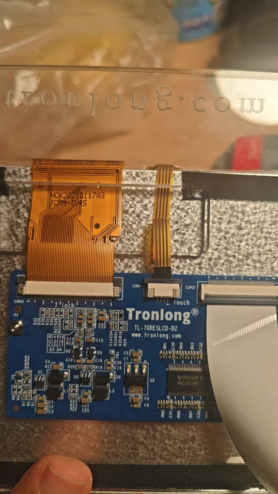

# 屏幕后部实物识别补充（2026-10-19）

用户确认目前资料只有已提供的文件，并补充屏幕后部照片。本轮只归档照片、核对资料，不操作已停机板卡。

照片直接可确认：转接板厂商Tronlong、PCB型号 **TL-70RESLCD-B2**，有7inch、touch、CON2/CON3/CON4丝印。该型号与项目原有上电卡的记录一致，属于实物再次确认。

**TL-70RESLCD-B2是照片中转接板的型号，不能据此直接认定裸液晶面板型号或其全部电气时序。** 软排线印字受反光、走线与遮挡影响，不作猜测转录。现有800×480/7寸电阻触摸配置仍按原厂资料和已验证工程追溯，不能把PCB丝印当成分辨率/时序测量。

先从现有D盘资料、原厂工程与已保存配置继续核对；不要求用户重复上传已有资料。若最终仍缺某个发布所需参数，应记录准确缺项及其影响，而非填入猜测的时序约束。

照片原始字节SHA256及机器可读结论见[识别记录](identification-20261019.json)。照片已从临时剪贴板目录复制到本目录，后续可直接读取。

现有资料核对：TL070A规格书列出模组`070007T0-50`，但尚不能与照片中的裸屏直接等同；另已定位评估底板LCD接口原理图。准确路径和适用范围见[现有资料清单](available-source-notes-20261019.json)。聚焦检索暂未定位更准确的实物匹配时序/独立转接板原理图，不代表全部资料中一定不存在。
