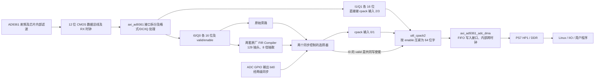

# P06 原厂 RX 接口图与 P07 接入边界

审阅日期：2026-10-11，Asia/Shanghai。状态：**只读源码审计；不是当前板卡位流或实时寄存器的证明，也没有实现 P07 接口。** 本轮未连接板卡、未改变射频配置、未烧写。

依据为留存的 `fpga/vendor-baseline/source/plutosdr-fw/hdl`。它来自用户原厂归档，文件指纹与摘录保存在 [独立证据](../../results/p06-vendor-rx-interface-20261011/source-evidence.json)。`xlslice` 默认参数另取本机 Vivado 2021.1 安装目录，明确区别于归档源码。本轮不替代主线程的构建结果。

## 1. 先看一条样本实际走哪里

通俗地说：AD9361 把无线电变成数字；接口核把交错到达的数字拆成 I 和 Q；第一路可选择直接经过，或先滤波并每 8 个输入产生约 1 个输出；打包器把选中的通道装进内存用的数据字；DMA 搬到 DDR。

“I0/Q0”是第一路接收通道的两个分量，不是两路天线。I1/Q1 是第二路接收通道。这份源码为 `CMOS_OR_LVDS_N=1`、`MODE_1R1T=0`，包含双通道能力；后者不是当前芯片一定运行双通道的证明，运行时还有 `adc_r1_mode`。

主要连接依据：`projects/pzp201/system_bd.tcl:205–238,253–282,320–351`。

## 2. 旁路与抽取究竟怎么选

| 项目 | 这份源码可确认的行为 | 尚不能据此确认的事 |
|---|---|---|
| 选择来源 | `up_adc_gpio_out → decim_slice → rx_fir_decimator/active` | 当前 BOOT 是否包含同样电路、Linux 是否已经写过该寄存器 |
| 选择位 | Tcl 未覆写 slice 参数；本机 2021.1 `xlslice` 默认输入 32 位、取 bit0、输出 1 位 | 最终生成 BD/XCI 仍应复核默认参数传播 |
| active=0 | 选择原来的 data/valid/enable，旁路 PL 抽取 | 不能等同于关闭 AD9361 芯片内部滤波 |
| active=1 | 选择 FIR Compiler 输出 data/valid，enable 仍来自原通道 | 不能据“存在 FIR”认定它正在启用 |
| 控制跨时钟 | `sync_bits` 两级触发器同步到 `l_clk`；同步器复位接常量 1 | 同步控制位不能自动保证切换时的数据连续、延迟对齐或边界清洁 |
| GPIO 初值 | `up_adc_common` 寄存器初始化及复位为 0；word 地址 `0x2f` 可读写 | 上电后驱动可能改写；源码复位值不是运行时读回 |

依据：`adi_fir_filter_bd.tcl:28–90`、`ad_bus_mux.v:57–59`、`sync_bits.v:50–80`、`up_adc_common.v:364–379,459`。AXI 到 UP 地址去掉低两位，因此该 GPIO 输出寄存器在此核内的字节偏移为 `0xBC`；原 BD 核基址为 `0x79020000`。这只是地址映射审计，不是建议绕过驱动直接写寄存器。

FIR 输入持续连接原始 data/valid，即使输出选旁路，它也没有因此停算。共享 Tcl 不连接 FIR 的输入 ready，也没有为该层级显式接入复位。新增模块不能沿用一个“只要有 valid 就能无限接收”的假设；应检查生成 IP 的实际 ready/复位接口及吞吐配置。

**第二路的重要限制：** I1/Q1 没有进入上述 FIR，且 `cpack/fifo_wr_en` 只取第一路 I0 所选路径的 valid。当 active=1 时，不能声称第二路也经相同的抗混叠滤波或与第一路具有相同延迟。第一版宜保持已验证的单 RX0 路径；若需要双路，必须单独验证第二路的抽样时刻、滤波和对齐。

## 3. 原厂 FIR 与 P07 自制 FIR 不同

| 属性 | 原厂 RX 抽取层级 | 当前 P07a 独立候选 |
|---|---|---|
| I/Q 结构 | 两个 FIR Compiler，各处理一个 16 位分量 | 自制双分量串行 MAC |
| 抽头数 | COE 中实际 129 项，对称 | 63 项 |
| 采样数变化 | 8 倍抽取 | 不抽取 |
| 系数 | 原 `util_fir_int/coefile_int.coe`，signed 16，整数系数、小数位 0 | signed 18、17 小数位 |
| 输入 | 层级 data 为 16 位；IP `Data_Fractional_Bits=15` | signed 12 位原始 counts |
| 输出 | 16 位；`Symmetric_Rounding_to_Zero` | 16 位、最近偶数舍入、显式饱和与标志 |
| 设计参数 | `Clock_Frequency=61.44`、`Sample_Frequency=61.44` MHz | 1 MS/s 离线参考；100 MHz 仅为已做仿真的测试时钟 |

COE 实数统计：129 项、系数和 131074、绝对值和 210634、最小 -3133、最大 16384。这是原整数系数统计，**不能由系数和直接宣称硬件输出单位增益**。输出位选取、缩放、舍入、溢出及完整流水延迟须从最终 IP 配置和仿真确认，不能套用 P07 的 Q17 右移和饱和算法。129 抽头的对称性也不等于已经测得整条硬件链路延迟。

`61.44` 是生成 FIR 硬件时使用的设计参数，Tcl 不会因此把 AD9361 采样率设置成 61.44 MS/s。实际输入样本由 valid 指示。

## 4. 数据格式和时钟域

AD9361 引脚是 12 位数据总线。`axi_ad9361_rx_channel` 内还会经过数据格式转换、可配置 DC 处理和 IQ 校正，最后导出的 `adc_data_i0/q0` 已是 **16 位总线**。`ad_datafmt` 保留低 12 位，可按软件控制进行符号扩展或翻转最高有效位；它不是自动左移 4 位。DC/IQ 处理和原厂 FIR 后不能默认结果仍落在 signed 12 位范围。

因此，把这些 16 位输出直接截取低 12 位接 P07 可能造成回绕错误。应先确定输入点、数据格式寄存器与幅度范围，再设计明确的缩放/舍入/饱和规则。

| 时钟或节拍 | 来源与用途 | 含义 |
|---|---|---|
| `l_clk` | 默认由 AD9361 `rx_clk_in` 经接收时钟接口产生，回接 `axi_ad9361/clk` | 接口数据时钟，不保证每拍都有一个复数样本 |
| RX FIR / cpack / DMA FIFO 写侧 | 均接 `axi_ad9361/l_clk` | 这一段源码没有额外 100 MHz 数据域 |
| `sys_cpu_clk` | PS FCLK0，配置 100 MHz；DMA DDR 写侧及 HP1 时钟 | DMA 内部完成与采样域的跨时钟配合 |
| `sys_200m_clk` | PS FCLK1，配置 200 MHz，接 AD9361 delay clock | 接口延迟校准用途，不是 200 MS/s 接收率 |
| RX 约束 | XDC `rx_clk` 周期 16.27 ns，约 61.463 MHz | 时序约束，不能当作板上实测时钟 |

CMOS 解帧在运行时单/双 RX 模式下产生不同 valid 图样：正常单路帧可每个 `l_clk` 得到一对 I/Q，双路帧需要两拍组合两路各一对 I/Q。应以实际运行模式和有效脉冲计数确认，不能仅拿时钟频率当采样率。

`util_cpack2` 默认 4 个 16 位分量、每分量每次 1 样本，输出 64 位。通道次序为低位先 I0、Q0、I1、Q1；按 enable 去掉未启用通道并压紧。只启用 I0/Q0 时，64 位字可容纳两个相邻复数样本；因此 **64 位 DMA 字率不等于复数采样率**。具体缓存/IIO 字节布局还需按 scan mask/scan format 实测。

cpack 注释明确无反压，只把下游 overflow 回传。原 BD 又把 overflow 接到 `axi_ad9361/adc_dovf`。ADC 数据不会因为新的 FIR `s_ready=0` 自动暂停；DMA FIFO 也不能弥补长期平均处理速度不足。

## 5. 30.72 MS/s 与 DMA 有效采样率如何区分

定义 `Fphy` 为 AD9361 向 FPGA 提供的每路复数样本率；不是 ADC 芯片内部最高转换时钟。定义 `Fstream` 为已启用单 RX0 在无丢样、模式稳定时送往 DMA 的复数样本率。

对于**确实运行本源码对应电路**且驱动配置匹配的情况：

- PL 旁路：`Fstream = Fphy`。
- 选择原厂 8 倍抽取：`Fstream = Fphy / 8`，稳态下按有效输入样本计数，不是按主机收包次数计数。
- 若 `Fphy = 30.72 MS/s`，两个条件值分别为 **30.72 MS/s** 和 **3.84 MS/s**。

这些是条件推导，**不是当前板卡已经运行 3.84 MS/s 的结论，也不是把旧文件一律除以 8 的依据**。当前运行的 BOOT 与此归档没有建立身份对应；本轮也没有读取运行时 active、驱动抽取控制或 capture 设备有效采样率。

现有 `rx_monitor.py:159–163` 用 `sdr.sample_rate` 保存 `sample_rate_hz`，还检查了 `cf-ad9361-lpc` 的 12/16 位、shift0 扫描格式；这不能单独证明 PL 抽取开关。接入前应分别保存 PHY 采样率、capture 设备采样率（若驱动提供）、PL 抽取状态及有效数据率的来源。若 capture 属性已报告抽取后速率，则不能再除一次 8。

如果实际抽取 8 倍而频谱仍使用 PHY 采样率，横坐标和带宽会放大 8 倍，按点数计算的持续时间会缩小 8 倍。此处仅说明风险，不改写任何历史结果。主机一次读取耗时还包含 USB/网络/调度，不足以证明样本间隔或没有丢样。

## 6. P07 接入前的最小核验项

1. **完成原样构建并记录最终配置。** 固定源树、工具、bit/XSA 指纹；核对生成后的 slice bit0、FIR 参数/实际接口、各时钟、复位及资源时序。构建成功不自动证明当前 BOOT 相同。
2. **读清运行时单 RX0 状态。** 后续独立板端步骤核对实际固件身份、PHY/capture 采样率、抽取选择、通道 enable、格式/DC/IQ 设置、scan layout 和 overflow。先确认软件读回途径，不在本文提供盲写地址命令。
3. **证明数据率与数值尺度。** 受控单音或确定性序列验证频率轴；计数 valid/输出点数验证抽取；覆盖正负极值、DC/冲激及 16 位结果是否超过 signed 12 位，记录缩放、舍入、溢出规则。板端与 Python 使用同一段输入和同一有效采样率。
4. **选定可承受的接入结构。** 2026-10-11 时序修正后的 P07a 每 66 拍接收一对 I/Q；即使真正达到 100 MHz，平均上限也仅约 1.515 MS/s，内部综合估计已通过但布局布线/上板仍待验证。30.72/8=3.84 MS/s 仍然过快；若直接放进 `l_clk` 域，还要按该域实际频率重新计算。跨到 100 MHz 需要明确 CDC/FIFO，有限缓存不能解决长期超速。先决定采样率/进一步抽取/并行结构或有明确丢弃规则的独立分析支路，不能直接接现有串行核。旧 65 拍数为修改前的历史仿真结果。
5. **验证转换边界和恢复。** TestBench 覆盖 I/Q 同时有效、突发/间断 valid、旁路切换、复位、DMA 未准备/overflow、启用掩码与打包顺序，逐点比较独立参考；明确丢样/模式切换应结束旧记录并重新起帧。不要直接把 FIR 输出 ready/valid 硬套到无反压 ADC 通路。

本轮新增的是接口审计文档和只读证据。P07a 仍是独立定点/RTL 仿真候选，尚未接入原厂链路；原厂 FIR、AD9361 芯片内部 FIR 与项目自制 FIR 分别记录。
